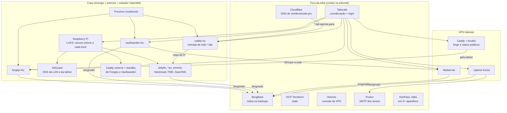

# Mapa de dependências

O que cai junto quando uma peça cai. Serve para duas perguntas no dia ruim:
**"isso fora explica aquilo fora?"** e **"de onde eu ainda consigo agir?"**.
O procedimento de cada caso está no doc da última coluna.

## As peças

Leitura do desenho: uma seta sai de quem é necessário e chega em quem
precisa dele. Quem tem muitas setas saindo é ponto único de falha.

## O que cai junto

| Se cair... | Cai junto | Continua de pé | Doc |
|---|---|---|---|
| **Energia ou internet de casa** | Proxmox, Pi e tudo do `*.lab`; DNS da tailnet (AdGuard); `forge` dá 502 | VPS: status page, Uptime Kuma (avisa por e-mail via Proton), Mailserver recebendo | — |
| **Proxmox** | Forgejo, Vaultwarden, Bread of Life, runner e **todo o `*.lab`**, inclusive os sites do Pi (o curinga aponta para o `caddy-lxc`) | Pi e os serviços dele por IP Tailscale; VPS | [`pi-recuperacao.md`](../ansible/docs/pi-recuperacao.md) |
| **Pi reiniciado** (queda de luz, reboot) | Todos os containers do Pi até o `secure-unlock`, inclusive o **AdGuard**: LAN e tailnet ficam sem DNS | Proxmox e os LXCs (DNS próprio, ADR 0023); VPS | [`pi.md`](../ansible/docs/pi.md), "A cada boot" |
| **Pi perdido** (SSD, hardware) | O mesmo, e os dados locais | Backups no BorgBase | [`pi-reconstrucao.md`](../ansible/docs/pi-reconstrucao.md) |
| **VPS** | `forge` público, status page, Uptime Kuma (**ninguém avisa** que algo caiu), Mailserver, sites `*.lab` da VPS | Tudo de casa, pela tailnet | [`vps.md`](../ansible/docs/vps.md), "VPS nova" |
| **Tailscale** (serviço ou sua conta) | Todo acesso privado: `*.lab`, Vaultwarden, SSH, Git, IMAP/SMTP dos clientes de correio (ADR 0028), Ansible | O que é público: `forge`, status page, Funnel do FMD; os consoles externos | — |
| **Cloudflare** | Resolução de todos os nomes, inclusive o MX; renovação de certificado (DNS-01) | Os serviços em si, por IP Tailscale ou `<host>.<tailnet>.ts.net` | — |
| **Desktop de operação** | Rodar Ansible e Terraform (`vault.yml`, `tfvars`, login do HCP) | Toda a infra, que não depende dele para rodar | [`maquina-nova.md`](maquina-nova.md) |
| **BorgBase** | Backups novos e qualquer restore | Os serviços no ar | [`backup.md`](../ansible/docs/backup.md) |

## Sem tailnet: o que um aparelho alcança

Aparelho fora da tailnet (emprestado, celular novo, Tailscale fora):

| Funciona | Não funciona |
|---|---|
| `https://status.nextlevelcode.pro` (status page) | Qualquer `*.lab.nextlevelcode.pro` |
| `https://forge.nextlevelcode.pro` (leitura, atrás do Anubis) | `git push`/`pull` por SSH (`forgejo-lxc:2222`) |
| `https://fmd.<tailnet>.ts.net` (Funnel do FMD) | Vaultwarden (só pelo Caddy interno) |
| Consoles: Tailscale, Cloudflare, Hetzner, BorgBase, HCP Terraform | SSH em qualquer máquina |
| E-mail chegando no MX (o servidor recebe) | Ler e enviar pelo Mailserver (IMAP/SMTP só pela tailnet) |
| Caixa do Proton (onde chegam os avisos do Uptime Kuma) | Nextcloud, Immich, Jellyfin |
| Cofre do Bitwarden **em cache** num app já logado (só leitura) | Sincronizar o cofre |
| KeePass `.kdbx` copiado no aparelho | — |

Aparelho **novo dentro da tailnet** já abre os `*.lab`, o Vaultwarden e o
Git por SSH, mas não administra nada: as portas 22, 8006 e 8080 só aceitam os IPs de
`infra-admin-1` e `infra-admin-2` na ACL (`tailscale/policy.hujson`).
Transformar o aparelho em estação de operação é trocar um desses IPs no
console, à mão: a ACL real só existe lá, o repo guarda placeholders.

## Dependências circulares

Laços em que a ferramenta de recuperação depende do que ela recupera. Cada
um tem uma saída que não passa pela infra:

| Laço | Saída |
|---|---|
| A chave SSH está no agente do Bitwarden, que sincroniza do Vaultwarden, que roda num LXC acessado por SSH | Cache do Bitwarden no aparelho; senão o anexo `id_ed25519` do KeePass ([`fora-da-infra.md`](fora-da-infra.md)) |
| O `~/Work` e o `~/.ssh` do desktop voltam pelo Nextcloud do Pi | KeePass + clone de qualquer remote ([`maquina-nova.md`](maquina-nova.md#sem-o-nextcloud)) |
| O remote deste repo é o Forgejo, que este repo reconstrói | Qualquer clone local serve; os docs estão nele |
| O 2FA por e-mail do Vaultwarden sai pelo Mailserver da VPS | App já logado continua abrindo o cofre; o código só é pedido em login novo |
| A passphrase do LUKS e a senha mestra do KeePass só existem na sua cabeça | Nenhuma, de propósito: é o limite do que a segunda pessoa consegue fazer sozinha |
| O Uptime Kuma avisa que algo caiu, mas mora na VPS | Ninguém avisa da VPS fora: a status page não abre e o e-mail não chega. O silêncio também é sinal |

## Lacunas

O que o mapa mostra sem saída hoje:

- **Logins das contas externas sem cópia fora da infra.** A tabela de
  [`fora-da-infra.md`](fora-da-infra.md) tem o login do HCP Terraform, mas
  não o do Tailscale, da Cloudflare, da Hetzner e do BorgBase. Se eles
  moram só no Vaultwarden, o cache do Bitwarden no celular é a única saída.
- **Queda de luz tranca o Pi.** Ele volta pedindo o `secure-unlock`, e até
  lá a LAN e a tailnet ficam sem DNS
  ([`adguard.md`](../ansible/docs/adguard.md), "Limitações").
- **O Proxmox depois de uma queda longa.** Não está documentado se o
  notebook liga sozinho quando a energia volta (opção da BIOS).
- **A VPS é o único observador de fora.** Com ela fora, a status page não
  abre e nenhum aviso chega.

## Manter este mapa

Serviço ou máquina nova muda o mapa quando cria uma seta nova: depende de
outra máquina, de uma conta externa ou da tailnet de um jeito que não está
aqui. Atualize no mesmo PR.
