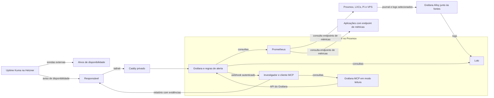

# Plano de observabilidade do homelab

**Status em 22/11/2026:** arquitetura-alvo proposta. Ensaios e implantação
ainda pendentes.

O [Uptime Kuma na Hetzner](../../ansible/docs/uptime-kuma.md) já avisa quando
um serviço fica inacessível. A observabilidade deve ajudar a investigar
também quando o serviço responde, mas fica lento ou começa a devolver erros.
O objetivo é seguir um incidente do primeiro sinal até um diagnóstico
verificável, primeiro manualmente e depois com auxílio de um agente.

## Arquitetura-alvo

O primeiro destino para produção é um LXC dedicado no Proxmox, com Docker
Compose gerenciado por Ansible. O Terraform cria o LXC e o inclui no
inventário. O Ansible configura os serviços, os coletores, o Caddy privado,
as fontes de dados, os painéis e as regras de alerta a partir de arquivos
versionados. Essa divisão segue os ADRs
[0002](../decisoes/0002-terraform-cria-ansible-configura.md) e
[0006](../decisoes/0006-role-compose-stack-compartilhado.md).

O acesso humano passa pelo [Caddy privado](../../ansible/docs/caddy.md).
O investigador roda no mesmo perímetro privado da stack. A API do Grafana e o
webhook ficam acessíveis só aos consumidores previstos. O Prometheus precisa
alcançar os endpoints de métricas autorizados, e os coletores precisam
alcançar a ingestão do Loki. Definir os fluxos por origem, destino e
porta antes de aplicar as [regras da tailnet](../../ansible/tailscale/README.md).
O Kuma segue na VPS. Se o Proxmox cair, ele pode perceber a perda dos alvos
externos, enquanto o Grafana e o histórico local ficam indisponíveis.

| Sinal | Fluxo e pergunta que responde |
| --- | --- |
| Métricas | O Prometheus coleta de exporters e endpoints HTTP. PromQL mostra quando a latência ou a taxa de erros mudou, qual serviço foi afetado e por quanto tempo. |
| Logs | Alloy encaminha fontes selecionadas do journal, do Caddy ou do Docker ao Loki. LogQL encontra eventos de um serviço na janela do incidente. |
| Correlação | Serviço, ambiente e janela de tempo ligam consultas agregadas a eventos: a métrica aponta quando, e o log da mesma janela mostra o quê. |

O Grafana consulta os dois backends. Na sigla LGTM, o M é Mimir. Nesta
proposta, o Prometheus guarda e consulta as métricas. Avaliar o Loki
em modo monolítico e escolher o armazenamento suportado pelas versões
testadas. Medir CPU, RAM, escrita e crescimento diário em disco antes de
fixar retenção, tamanho dos volumes e orçamento por sinal. Começar pelos
logs que respondem a perguntas do piloto. Usar labels estáveis como
serviço e ambiente. IDs de requisição ficam como campos da
telemetria, fora das labels.

Separar a recuperação da configuração da recuperação do histórico. O Git e
o vault permitem recriar a configuração e as credenciais. Definir quais dados
persistentes merecem backup a partir da janela de investigação necessária,
e ensaiar a restauração correspondente. Documentar a volta da última versão
validada e os limites de rollback quando houver migração de dados.

### Traces ficam de fora

Trace só existe em código instrumentado: a própria aplicação cria os spans
e repassa o `trace_id` a quem ela chama. Os serviços do homelab são de
terceiros (Jellyfin, Immich, Nextcloud, Forgejo) e, sem instrumentação
embutida, um Tempo receberia no máximo os spans do proxy, que só repetem a
latência que a métrica já mostra. Métricas e logs da mesma janela cobrem as
perguntas do piloto.

OpenTelemetry e Tempo voltam ao plano quando houver código próprio em
produção para instrumentar, ou um serviço de terceiros que exporte traces
e cuja lentidão métricas e logs não expliquem.

## Trilha de aprendizado e implantação

### 1. Investigar manualmente no lab

Usar o repositório `lab`, na rede isolada do
[ADR 0021](../decisoes/0021-lab-numa-bridge-propria-que-so-sai-para-a-internet.md),
com dados e credenciais fictícios. Criar uma aplicação HTTP simples, sem
estado persistente, que chama uma segunda aplicação. A segunda deve permitir
introduzir latência e erros de forma controlada.

1. Subir Prometheus e Grafana. Conferir o conteúdo de `/metrics`, os alvos
   coletados e consultas PromQL para taxa, erros e latência. Montar os
   painéis a partir dessas consultas.
2. Adicionar Alloy e Loki. Emitir logs estruturados e encontrar uma falha
   conhecida por serviço e intervalo com LogQL.
3. Criar uma regra de alerta para o cenário. Observar disparo e recuperação,
   e distinguir ausência de dados de um serviço saudável.

**Critério de saída.** A mesma falha pode ser reproduzida e explicada
manualmente, com janela de tempo, consultas e logs correspondentes.

### 2. Repetir a investigação com MCP

Conectar um cliente MCP ao [servidor MCP do Grafana](https://github.com/grafana/mcp-grafana).
Usar uma conta de serviço dedicada, com as permissões mínimas verificadas na
edição e versão instaladas. Desativar operações de escrita no MCP e expor
somente as ferramentas de consulta necessárias. Ensaiar com os dados
sintéticos da etapa anterior. Antes de usar dados reais, definir onde o
modelo roda e quais campos e fontes podem chegar a ele. Filtrar credenciais,
cabeçalhos de autenticação, dados pessoais e conteúdo sensível na coleta.
Limitar intervalo, volume e tempo das consultas. Tratar instruções
encontradas em logs como conteúdo do evento.

**Critério de saída.** Dado o mesmo intervalo do ensaio manual, o agente
localiza o erro e devolve serviço, impacto observado, consultas ou links,
hipótese e lacunas. Verificar que a identidade usada para consultar o Grafana
também é impedida de escrever pela API.

### 3. Disparar a investigação pelo alerta

Configurar um [webhook do Grafana](https://grafana.com/docs/grafana/latest/alerting/configure-notifications/manage-contact-points/integrations/webhook-notifier/)
para o receptor privado. O receptor autentica o evento, usa seu serviço e sua
janela para iniciar a investigação e agrupa reenvios da mesma ocorrência.
O MCP dá acesso às consultas. A entrega do relatório fica a cargo do
investigador, por um canal privado a definir (por exemplo, Slack).
Configurar a notificação original por um caminho independente para que ela
chegue mesmo se a investigação falhar ou exceder seu tempo limite.
O responsável decide e executa intervenções na infra.

**Critério de saída.** Um incidente conhecido dispara o alerta e gera um
relatório verificável. Repetir com evento duplicado, credencial inválida e
uma fonte ausente. Verificar que esses casos produzem resultados
distinguíveis e que o aviso original continua chegando.

### 4. Exercitar Kubernetes no lab

Reimplantar a mesma aplicação em VMs isoladas. Terraform provisiona as VMs,
Ansible prepara o Linux e instala o cluster, e Kubernetes reconcilia a
aplicação a partir dos manifestos. Usar um `Deployment` com duas réplicas e
um `Service` estável. Acessar pelo caminho de administração do lab. Para
ensaiar roteamento HTTP, adicionar um controlador e um `Ingress` privado.
Configurar o caminho de coleta da aplicação para a stack do lab e repetir
a falha da etapa 1.

**Critério de saída.** Observar a substituição de um Pod, a continuidade do
endereço do `Service` e o efeito no tráfego pela telemetria. Registrar também
o comportamento durante o desligamento de um nó e as condições em que o
cluster consegue criar o Pod em outro. Duas VMs no mesmo Proxmox compartilham
a falha do host.

A arquitetura-alvo adota Compose para observabilidade e usa Kubernetes na
trilha de aprendizado. Uma adoção posterior em produção depende de um
benefício operacional demonstrado no lab, como espalhar réplicas entre hosts
independentes, e de um desenho testado para rede, armazenamento, backup e
recuperação. A etapa de produção da observabilidade pode avançar em paralelo
a essa trilha.

### 5. Levar a coleta ao infra em partes

Entregar o LXC e sua configuração inicial no mesmo PR, seguindo o
[contrato de evidências](../fluxo-de-mudanca.md). Começar com métricas e
logs de um alvo autorizado, como o Caddy do caminho do Forgejo. Expandir
para outros serviços conforme a utilidade e o volume medido. Por
exemplo, a investigação de lentidão do Forgejo começa por métricas do
caminho HTTP e logs do proxy.
Habilitar a investigação automática depois de validar acesso, retenção,
conteúdo e recuperação com a coleta real.

**Critério de saída.** O responsável recebe um aviso externo do Kuma para
o cenário de indisponibilidade e consegue diagnosticar, no Grafana, o
cenário distinto de degradação com o serviço ainda acessível. Conferir
a reaplicação do Ansible, a exposição privada, o consumo de recursos e a
recuperação da stack. Na ativação do investigador, verificar o relatório e
a continuidade do alerta com o agente indisponível.

Para cada ensaio, registrar os SHAs do cenário e do código correspondente,
comandos literais, versões, resultado, alcance e limites. Usar cópias
independentes no `lab`. Nos PRs de implementação, documentar os passos
manuais nos guias dos serviços, com comando, verificação e o motivo de serem
manuais. Registrar em ADR, junto da implementação, as decisões duradouras
confirmadas pelo ensaio. As execuções com efeitos seguem as autorizações do
contrato de evidências.

## Issues e referências

- [#61](https://forge.nextlevelcode.pro/nextlevelcode/infra/issues/61) investiga
  os travamentos do Pi. O Loki remoto pode preservar eventos já recebidos
  antes da interrupção, o que ajuda a recuperar a cronologia.
- [#83](https://forge.nextlevelcode.pro/nextlevelcode/infra/issues/83) acompanha
  a auditoria que identificou a necessidade de limitar os logs locais. A
  retenção do Loki e a rotação local resolvem problemas complementares.
- [#120](https://forge.nextlevelcode.pro/nextlevelcode/infra/issues/120) trata
  do canal de notificações do Uptime Kuma.
- [Tutorial de Grafana e Prometheus](https://www.youtube.com/watch?v=vf5MJLoXUG0)
  e [tutorial de investigação com MCP](https://www.youtube.com/watch?v=7rZBNklWOJE)
  embasam o fluxo de telemetria até o alerta e a investigação.
- [Prometheus](https://prometheus.io/docs/introduction/overview/),
  [Grafana Alloy](https://grafana.com/docs/alloy/latest/introduction/)
  e [Loki monolítico](https://grafana.com/docs/loki/latest/get-started/deployment-modes/)
  servem de referência para a coleta e a correlação.
- As transcrições dos tutoriais de Kubernetes serviram de base para a
  trilha do lab. A documentação oficial detalha os
  [componentes do cluster](https://kubernetes.io/docs/concepts/overview/components/),
  [Deployment](https://kubernetes.io/docs/concepts/workloads/controllers/deployment/),
  [Service](https://kubernetes.io/docs/concepts/services-networking/service/) e
  [Ingress](https://kubernetes.io/docs/concepts/services-networking/ingress/).
